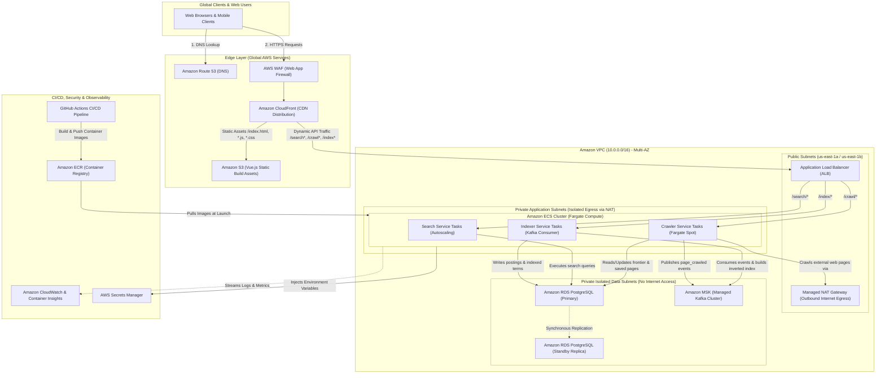
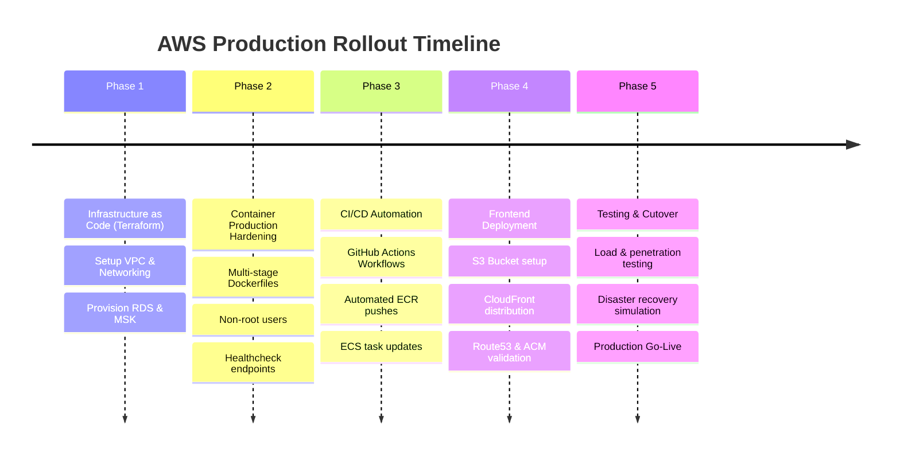

# 🚀 AWS Production Cloud Architecture & Deployment Blueprint: Distributed Search Engine

> **Authored by:** Principal Cloud Solutions Architect & DevOps Lead (10+ Years Experience)  
> **Project:** Distributed Microservices Search Engine (FastAPI, Vue.js SPA, PostgreSQL, Apache Kafka, Nginx/ALB)

---

## 1. Executive Summary & Production Philosophy

Migrating a multi-tier microservices application from a local `docker-compose` environment to an enterprise-grade AWS production deployment requires a transition from basic container hosting to **cloud-native resilience, elasticity, and zero-trust security**.

### Core Architecture Pillars:
1. **High Availability & Fault Tolerance:** Multi-AZ deployment across at least two Availability Zones with zero single points of failure (SPOF).
2. **Managed & Serverless-First:** Eliminating EC2 operating system patching and cluster maintenance overhead by adopting AWS managed services (ECS Fargate, Amazon RDS, Amazon MSK, Amazon CloudFront).
3. **Zero-Trust Security & Deep Isolation:** Pure private network isolation for backend services and data stores; public surface area limited exclusively to the CDN and Application Load Balancer.
4. **FinOps & Cost Optimization:** Leveraging **AWS Fargate Spot** for stateless background crawlers (up to 70% savings), combined with auto-scaling policies based on traffic demand.

---

## 2. Component Mapping: Local vs. AWS Production

| Component | Local Development (`docker-compose`) | AWS Production Equivalent | Strategic Rationale |
| :--- | :--- | :--- | :--- |
| **Frontend UI** | Containerized Nginx / Vite dev server | **Amazon S3 + CloudFront (CDN) + ACM (SSL)** | Sub-millisecond global caching via edge points of presence (PoPs), automated DDoS mitigation via AWS Shield Standard, and near-zero hosting cost. |
| **API Gateway** | Custom Nginx Container (`search_gateway`) | **Application Load Balancer (ALB)** | Native Layer-7 path-based routing (`/search`, `/crawl`, `/index`), automated SSL termination via ACM, native health checks, and zero container IP caching issues. |
| **Search Service** | FastAPI Container | **Amazon ECS on AWS Fargate** | Serverless container execution, autoscaling dynamically with query load and CPU/Memory utilization. |
| **Indexer Service** | FastAPI + Kafka Consumer Container | **Amazon ECS on AWS Fargate** | Dedicated worker tasks consuming from Kafka topics, autoscaling based on Kafka consumer lag. |
| **Crawler Service** | FastAPI + Async Engine Container | **Amazon ECS on AWS Fargate Spot** | Stateless asynchronous crawling engine using spare AWS compute capacity for up to 70% cost reduction. |
| **Primary Database** | PostgreSQL Container | **Amazon RDS PostgreSQL (Multi-AZ)** | Automated failover, automated point-in-time snapshots, encrypted data at rest (AWS KMS), and managed engine upgrades. |
| **Event Broker** | Kafka & Zookeeper Containers | **Amazon MSK (or MSK Serverless)** | Fully managed, highly available Apache Kafka cluster with automated broker replacement and partition balancing. |
| **Secrets & Config** | `.env` files / Docker environment variables | **AWS Secrets Manager & Parameter Store** | Encrypted storage, runtime injection without exposing values in source control, and automated credential rotation. |

---

## 3. End-to-End Architecture Diagram



---

## 4. Network Topology & VPC Blueprint

### Subnet Allocation Strategy (`10.0.0.0/16`)
Designed with high availability across two Availability Zones (`us-east-1a` and `us-east-1b`):

1. **Public Subnets (`10.0.1.0/24`, `10.0.2.0/24`):**
   - Attached to the Internet Gateway (IGW).
   - Houses the **Application Load Balancer** and **Managed NAT Gateway**.
   - No microservice containers or databases are placed here.
2. **Private Application Subnets (`10.0.10.0/24`, `10.0.20.0/24`):**
   - Route table defaults `0.0.0.0/0` outbound via the NAT Gateway.
   - Houses the **ECS Fargate Tasks** (Search, Crawler, Indexer).
   - The Crawler service requires outbound internet to fetch crawled domains.
3. **Private Isolated Database Subnets (`10.0.30.0/24`, `10.0.40.0/24`):**
   - Strictly isolated with **no Internet Gateway or NAT Gateway route**.
   - Houses **Amazon RDS PostgreSQL** and **Amazon MSK**.
   - Accessible exclusively from the Private Application Subnets via Security Groups.

### Security Groups (Least-Privilege Firewalls)
- **`ALB-SG`:** Allows inbound `443` (HTTPS) and `80` (HTTP redirect) from `0.0.0.0/0`.
- **`ECS-Service-SG`:** Allows inbound traffic on port `8000` **only if the source is `ALB-SG`**.
- **`RDS-SG`:** Allows inbound PostgreSQL traffic on port `5432` **only from `ECS-Service-SG`**.
- **`MSK-SG`:** Allows inbound Kafka broker traffic on ports `9092/9094` **only from `ECS-Service-SG`**.

---

## 5. Ingress & Routing Architecture

### Replacing the Containerized Nginx Gateway
Locally, Nginx was handling reverse proxying, CORS, and routing to containers. In AWS, this is replaced by a native cloud infrastructure pattern:

1. **CloudFront Distribution (Edge Origin Request Routing):**
   - **Default Behavior (`/*`):** Directed to the private S3 bucket containing the built Vue.js single-page application.
   - **API Behaviors (`/search*`, `/crawl*`, `/index*`):** Directed to the **ALB domain** as a custom origin, passing all headers, cookies, and query strings directly.
   - **Benefit:** Eliminates CORS entirely because both frontend assets and backend APIs share the same domain (`https://search.yourdomain.com`).
2. **Application Load Balancer (ALB Path-Based Routing Rules):**
   - Rule 1: `IF Path = /search* THEN Forward to Search-Target-Group (Port 8000)`
   - Rule 2: `IF Path = /crawl* THEN Forward to Crawler-Target-Group (Port 8000)`
   - Rule 3: `IF Path = /index* THEN Forward to Indexer-Target-Group (Port 8000)`
   - Default: `Return 404 Fixed Response`

---

## 6. Phased Implementation Roadmap



### Phase 1: Infrastructure as Code (IaC) via Terraform
Create a clean modular Terraform structure:
- `modules/vpc`: VPC, public/private subnets, NAT Gateway, route tables.
- `modules/rds`: PostgreSQL Multi-AZ instance, KMS encryption, parameter groups.
- `modules/msk`: MSK cluster, SASL/SCRAM authentication, security groups.
- `modules/ecs`: ECS cluster, task definitions, IAM execution roles.
- `modules/alb`: Application Load Balancer, listeners, target groups, routing rules.

### Phase 2: Production Containerization
- **Multi-Stage Builds:** Strip build tools and reduce final image sizes to `< 150MB` using `python:3.11-slim`.
- **Security:** Ensure containers execute as non-root user (`appuser` with UID 1001).
- **Health Checks:** Implement robust `/health` endpoints in FastAPI that verify database pool connectivity before reporting healthy.

### Phase 3: Automated CI/CD Pipelines (GitHub Actions)
For every commit pushed to the `main` branch:
1. **Lint & Test:** Run Pytest for backend services and `vue-tsc` / `vitest` for the frontend.
2. **Docker Build & Tag:** Tag images with the specific Git commit SHA and latest tag.
3. **ECR Push:** Authenticate via AWS OIDC (no hardcoded credentials) and push to Amazon ECR.
4. **Deploy to ECS:** Update ECS task definitions with the new image tag and trigger zero-downtime rolling deployment.
5. **Frontend Sync:** Run `npm run build` for the Vue SPA, sync files to S3, and trigger CloudFront cache invalidation.

---

## 7. Security, Secrets & Zero-Trust Governance

1. **Authentication & Identity (AWS IAM OIDC):**
   - GitHub Actions connects to AWS using an **IAM OpenID Connect (OIDC) Role**, avoiding static `AWS_ACCESS_KEY_ID` and `AWS_SECRET_ACCESS_KEY` storage in repository secrets.
2. **Runtime Secret Injection:**
   - Database passwords and Kafka connection strings reside in **AWS Secrets Manager**.
   - ECS Task Definitions reference secrets directly:
     ```json
     {
       "name": "DATABASE_URL",
       "valueFrom": "arn:aws:secretsmanager:us-east-1:123456789012:secret:search-engine/db-credentials:url::"
     }
     ```
   - No application logs or container images will ever contain plain-text credentials.
3. **Data Encryption:**
   - **At Rest:** Amazon RDS, MSK, S3, and Secrets Manager encrypted with AWS Key Management Service (KMS).
   - **In Transit:** TLS 1.3 enforced across CloudFront, ALB, and internal Kafka communication.

---

## 8. Observability, Monitoring & Alerting

1. **Amazon CloudWatch Container Insights:**
   - Provides per-task CPU, memory, network, and storage tracking.
2. **Centralized Log Aggregation:**
   - All stdout/stderr logs from FastAPI and Kafka consumers stream to CloudWatch Logs with a 30-day retention policy.
3. **Critical Automated Alarms (AWS SNS + Slack/Email Notifications):**
   - `HighHTTP5XXErrors`: Fires if ALB receives `> 1%` 5xx status codes over 5 minutes.
   - `DatabaseHighConnections`: Fires if RDS connections reach `> 80%` of max pool capacity.
   - `KafkaConsumerLag`: Fires if the Indexer service falls behind publishing rate.
   - `CrawlerMemoryThreshold`: Fires if memory usage exceeds 85%, triggering automated task recycling.

---

## 9. Cost Analysis & Sizing Recommendations

| Tier | Infrastructure Specification | Estimated Monthly Cost | Suitable Use Case |
| :--- | :--- | :--- | :--- |
| **Startup / Staging** | - Single-AZ RDS PostgreSQL (`db.t4g.small`)<br>- MSK Serverless or small single-broker Kafka on EC2<br>- 100% ECS Fargate Spot for all tasks<br>- Single NAT Gateway / NAT Instance | **~$60 - $110 / month** | Development, testing, staging verification, demo environments. |
| **Enterprise Production** | - Multi-AZ RDS PostgreSQL (`db.r6g.large`) with Read Replicas<br>- Dedicated Amazon MSK Cluster (3 Brokers across 3 AZs)<br>- Reserved Fargate for Search & Indexer, Fargate Spot for Crawler<br>- Dual NAT Gateways across two AZs | **~$350 - $650 / month** | Production SLA, high search throughput, large-scale indexing. |

---

## 10. Disaster Recovery & Rollback Strategy

1. **Automated Zero-Downtime Rollback:**
   - ECS rolling deployments maintain previous task versions running until new tasks pass ALB target group health checks. If new tasks fail health checks, ECS aborts deployment and rolls back automatically.
2. **Point-In-Time Recovery (PITR):**
   - Enabled on Amazon RDS PostgreSQL with a 7-day retention period, allowing database restoration to any specific second in the event of accidental data corruption.
3. **Database Read Replicas:**
   - High-volume search queries can be offloaded to an RDS Read Replica, ensuring crawler and indexer write operations never degrade search latency.
